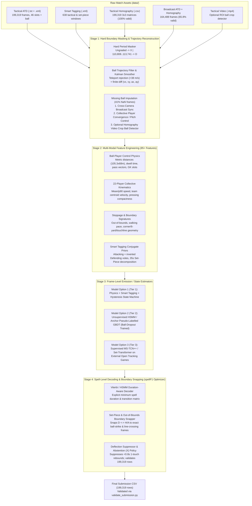

# More Than A Hack 2027 (Phase 1: Ball Possession) — Proposed Engineering & Modeling Plan

**Competition:** More Than A Hack 2027 — Phase 1: Frame-Level Ball Possession  
**Organisers:** Metrica Sports, FC Barcelona (Barça Innovation Hub), Mobile World Capital Barcelona  
**Match:** FC Barcelona (`H`) vs. Athletic Club (`A`) — LaLiga EA Sports 2024–25, Matchday 2  
**Primary Ranking Metric:** `spellF1` (`spell_f1_mean` across Temporal IoU $\in \{0.3, 0.4, 0.5, 0.6, 0.7\}$)  
**First Tie-Breaker:** `macroF1` (unweighted mean per-frame F1 across `H`, `A`, `D`)  
**Published Baseline Floor to Beat:** `baseline_smooth50` (`spellF1 = 0.2433`, `macroF1 = 0.6724` on full match)  
**Submission Deadline:** November 17, 2026  

---

## 1. Executive Summary & Forensic Diagnosis of the Challenge

The goal of Phase 1 is to output a single CSV file (`frame,label`) with **199,319 rows** (indexed `0 … 199,318` to the 25 fps tactical camera timeline), assigning every frame one of four labels:
* **`H`**: Home team (FC Barcelona) in controlled possession, ball alive.
* **`A`**: Away team (Athletic Club) in controlled possession, ball alive.
* **`D`**: Dead ball — play is stopped (out of bounds, foul, offside, pre-kickoff, goal celebration, set-piece setup).
* **`X`**: Abstain / ungraded frame.

### 1.1 Why Standard Frame Classifiers and the Baseline (`spellF1 = 0.2433`) Fail
A forensic inspection of the evaluation code ([possession_metrics.py](file:///c:/Users/gmbha/OneDrive/Desktop/Barca_Challenge/more-than-a-hack-2027/evaluation/possession_metrics.py)), the starter baseline ([baseline.py](file:///c:/Users/gmbha/OneDrive/Desktop/Barca_Challenge/more-than-a-hack-2027/starter/baseline.py)), and the raw match files in `data/` reveals five critical structural properties of this problem:

1. **`spellF1` Punishes Structural Errors, Not Interior Frame Errors:**
   * `spellF1` extracts maximal contiguous runs of `H` or `A` (treating `D` as stoppages and forward-filling `X` within each half), matches predicted spells 1-to-1 against ground-truth spells of the same team by Temporal IoU, and averages F1 over thresholds `0.3, 0.4, 0.5, 0.6, 0.7`.
   * **Splitting Penalty:** A single 2-frame flicker (`H -> A -> H` or `H -> D -> H`) in the middle of a 30-second possession splits 1 true spell into 2 predicted spells. At most one half can match the ground truth, its maximum possible IoU drops to $\le 0.5$ (failing the `0.6` and `0.7` thresholds), and the second half becomes a False Positive spell.
   * **Merging Penalty:** Missing a short dead-ball stoppage between two possessions by the same team (`H -> D -> H` predicted as `H -> H -> H`) merges two true spells into one, costing a False Negative spell and degrading IoU on the matched spell.
   * **Boundary Latency Penalty:** As documented in [EVALUATION.md](file:///c:/Users/gmbha/OneDrive/Desktop/Barca_Challenge/more-than-a-hack-2027/EVALUATION.md), a uniform 1-frame offset costs `0.0000` on `spellF1`, an 8-frame (`0.32s`) offset drops `spellF1` to `0.8933`, and a 25-frame (`1.0s`) offset drops `spellF1` to `0.6539`.

2. **Forensic Finding #1 — The Baseline Equates "Ball Missing" with "Dead Ball" (`D`), Which Is False in Both Directions:**
   * In [baseline.py](file:///c:/Users/gmbha/OneDrive/Desktop/Barca_Challenge/more-than-a-hack-2027/starter/baseline.py), raw frames where `ball_x` is `NaN` are left as `NOBODY` (`D`), and majority-vote smoothing (`smooth50`, $\pm 2\text{s}$) outputs `D` whenever the ball is invisible for $> 4\text{s}$.
   * **During Real Dead Balls (`D`), the Ball Is Often 100% Visible:** Our inspection of `BAR-ATH_tactical_atd.txt` against [BAR-ATH_possession_gt_public.csv](file:///c:/Users/gmbha/OneDrive/Desktop/Barca_Challenge/more-than-a-hack-2027/evaluation/gt/BAR-ATH_possession_gt_public.csv) shows that in Segment 15 (`[15889..16400)`, `20.44s` of `D`) and Segment 20 (`[18027..18389)`, `14.48s` of `D`), **the ball is visible on `100.0%` of frames** (sitting on the grass or rolling out of bounds). Similarly, during the graded 2nd-half pre-kickoff walk-up (`[110808..113742)`, `2,934` frames = `117.36s` of `D`), the ball is visible on **`2,370 / 2,934` (`80.8%`)** of frames! Because the ball is visible, `baseline_smooth50` predicts `H` or `A` across the entire stoppage.
   * **During Live Play (`H`/`A`), Missing Ball Gaps Are Long Contiguous Blocks:** Across all `158,857` graded frames, the ball is missing on `64,643` frames (`40.7%`), concentrated into **only 150 gaps**:
     * `<= 25` frames ($\le 1\text{s}$): `17` gaps (`75` frames total)
     * `26 .. 75` frames ($1\text{–}3\text{s}$): **`0` gaps** (Metrica's optical tracker already interpolated short gaps $\le 3\text{s}$!)
     * `76 .. 250` frames ($3\text{–}10\text{s}$): `54` gaps (`9,465` frames)
     * `> 250` frames ($> 10\text{s}$): `79` gaps (`55,103` frames)
   * Because live-play ball dropouts last $3\text{–}15+$ seconds (for example, inside Public GT Segment 16 `A`, where gaps of `5.28s` and `9.28s` occur during live Athletic Club attacking play), `baseline_smooth50` outputs false `D` stretches inside live possessions, fragmenting the full match into **594 spells** of mean duration **7.2s** (nearly $2\times$ the true spell count).

3. **Forensic Finding #2 — Collective 22-Player Kinematics Cleanly Separate Live Play from Stoppages:**
   * Even when the ball is `NaN` or sitting stationary on the pitch, **~20.5 player slots are actively tracked on every graded frame** with instantaneous speeds (`m/s`).
   * In the public 5-minute window, mean player speed across all tracked players is **`2.23 – 3.48 m/s`** during live play segments (`H`/`A`), but drops sharply to **`1.13 – 1.54 m/s`** (walking pace) during stoppages (Seg 6 `1.54 m/s`, Seg 15 `1.13 m/s`, Seg 18 `1.16 m/s`, and 2nd-half pre-kickoff `1.27 m/s`).

4. **Forensic Finding #3 — Smart Tagging Has Exact Conjugate Pairs and Fixed 35-Second Set-Piece Windows:**
   * Inspecting `BAR-ATH_tactical_smart_tagging.xml` (`638` intervals) reveals that Metrica's tactical classifier emits **exact-span dual conjugate pairs**:
     * `PROGRESSION(Team X)` $\iff$ `DEFENDING IN MIDDLE THIRD(Team Y)` (`66` pairs)
     * `CREATING CHANCES(Team X)` $\iff$ `DEFENDING IN DEFENSIVE THIRD(Team Y)` (`30` pairs)
     * `BUILD UP(Team X)` $\iff$ `DEFENDING IN ATTACKING THIRD(Team Y)` (`22` pairs)
     * `ATTACKING TRANSITION(Team X)` $\iff$ `DEFENSIVE TRANSITION(Team Y)` (`24` pairs)
   * When `DEFENDING *` tags are inverted to vote for the *opposing* (attacking) team, Smart Tagging covers **`68.1%` (`108,185 / 158,857`)** of all graded frames (`58.9%` unanimous team prior, `9.2%` transition overlap).
   * Furthermore, while the two `Kick Off (Start)` tags are `5.0s` (`125`-frame) windows around the kick (`11,185` and `113,742`), **all 57 other `SET PIECES` tags (`Free Kick`, `Goal Kick`, `Throw-in`, `Corner Kick`, `Kick Off (After Goal)`) are fixed `35.0s` (`875`-frame) windows** that span both the pre-kick dead-ball setup (`D`) and the post-kick live play (`H`/`A`). They must be decomposed algorithmically at the exact ball-strike frame $t_{\text{kick}}$.

5. **Forensic Finding #4 — ATD Raw Format Nuances (Goalkeepers, Attack Directions & Ball Velocity):**
   * In `BAR-ATH_tactical_atd.xml`, **Track 24** (`slot 23`, Barcelona) and **Track 46** (`slot 45`, Athletic Club) are explicitly tagged `<Value>Goalkeeper</Value>`. All other 44 slots are anonymous field-player tracklets.
   * Barcelona (`H`) attacks `left_to_right` ($x: 0 \to 1$) in the 1st Half and `right_to_left` ($x: 1 \to 0$) in the 2nd Half.
   * In `BAR-ATH_tactical_atd.txt`, the 3rd value of the ball tuple (`ball_s`) is `NaN` on `91.3%` of visible ball frames (`103,579 / 113,488`). Ball velocity $(v_x, v_y, \|\mathbf{v}\|)$ and acceleration must be computed via finite differences of $(ball_x \times 105.3, ball_y \times 68.0) \times 25\text{ fps}$ after filtering out single-frame tracker teleports ($> 38\text{ m/s}$).

---

## 2. Proposed End-to-End System Architecture

To maximize `spellF1` while respecting the strict rule against hand-labelling or tuning on the 5-minute public ground truth ([RULES.md](file:///c:/Users/gmbha/OneDrive/Desktop/Barca_Challenge/more-than-a-hack-2027/RULES.md)), we propose a modular **4-Stage Hybrid Physics + Probabilistic Sequence Architecture**:



---

## 3. Stage 1: Hard Boundary Masking, Cleaning & Missing-Ball Reconstruction

### 3.1 Exact Timeline Masking & The 2nd-Half Kickoff Rule
Using [games.py](file:///c:/Users/gmbha/OneDrive/Desktop/Barca_Challenge/more-than-a-hack-2027/games.py) (`half_video_blocks("BAR-ATH")`) and the published kickoff anchors (`11,185` and `113,742`):

| Frame Span | Count | Action | Justification |
| :--- | :---: | :--- | :--- |
| `0 … 11,184` | `11,185` | Hard-set to **`X`** | Pre-match ungraded span ([DATA.md](file:///c:/Users/gmbha/OneDrive/Desktop/Barca_Challenge/more-than-a-hack-2027/DATA.md)). |
| `11,185 … 90,651` | `79,467` | Predict **`H` / `A` / `D`** | 1st Half graded span (kickoff at `11,185`). |
| `90,652 … 110,807` | `20,156` | Hard-set to **`X`** | Halftime ungraded span. |
| `110,808 … 113,741` | `2,934` | Hard-set to **`D`** | **Graded pre-kickoff walk-up** (`117.36s` before 2nd-half kickoff at `113,742`, published in [FAQ.md](file:///c:/Users/gmbha/OneDrive/Desktop/Barca_Challenge/more-than-a-hack-2027/FAQ.md#L38-L41)). Fixing these 2,934 frames eliminates 2 minutes of false `H`/`A` spells immediately. |
| `113,742 … 190,197` | `79,390` | Predict **`H` / `A` / `D`** | 2nd Half active graded span. |
| `190,198 … 199,318` | `9,121` | Hard-set to **`X`** | Post-match ungraded span. |

### 3.2 Coordinate Normalization & Ball Trajectory Filtering
1. **Metric Scaling:** Convert all normalized `(x, y)` coordinates to real meters using `PITCH_LENGTH = 105.3`, `PITCH_WIDTH = 68.0` ([games.py](file:///c:/Users/gmbha/OneDrive/Desktop/Barca_Challenge/more-than-a-hack-2027/games.py#L61)):
   $$X_m = x \times 105.3, \qquad Y_m = y \times 68.0$$
2. **Half-Normalized Attack Direction:** Because Barcelona attacks left-to-right ($+X_m$) in Half 1 and right-to-left ($-X_m$) in Half 2, create half-normalized coordinates $\tilde{X}_m$ where Home always attacks toward $+105.3\text{m}$ and Away toward $0.0\text{m}$.
3. **Ball Teleport Rejection & Kinematic Derivatives:**
   * Compute raw frame-to-frame ball speed $v_{\text{ball}}(t) = 25 \cdot \sqrt{(X_{\text{ball}}(t) - X_{\text{ball}}(t-1))^2 + (Y_{\text{ball}}(t) - Y_{\text{ball}}(t-1))^2}$.
   * Any single-frame jump with $v_{\text{ball}}(t) > 38\text{ m/s}$ ($> 137\text{ km/h}$) that does not continue along a consistent trajectory is a false optical detection (e.g., white boots or pitch markings, which occurred 124 times during `110808..113742`) and is masked to `NaN`.
   * Apply a causal/bidirectional Constant-Velocity/Constant-Acceleration **Kalman Smoother** (or 5-frame Savitzky-Golay filter) over contiguous visible ball segments to estimate clean ball velocity $(v_{bx}, v_{by})$, speed $s_b$, acceleration $a_b$, and directional change angle $\Delta \theta_b(t)$ (which spikes sharply on kicks, passes, deflections, and interceptions).

### 3.3 Three-Tier Strategy for the 41% Missing Ball (`64,643` Graded Frames)
Because the 150 missing-ball gaps in the graded halves are almost all $3\text{–}15+$ seconds long (`133` gaps $> 75$ frames), simple linear interpolation of $(X_{\text{ball}}, Y_{\text{ball}})$ across a 10-second gap is physically invalid. Instead, we use a 3-tier reconstruction strategy:

* **Tier A — Broadcast ATD Cross-Camera Synchronisation (Data-Only, Fast & High-Yield):**
  * `data/broadcast/BAR-ATH_broadcast_atd.txt` has `164,488` frames on its own timeline, with valid homography on `65.8%` of frames (`108,233` frames) and ball visibility on `50.5%`.
  * Whenever a broadcast frame has `valid == 1` and low `reprojection_error < 2.0`, its 2D normalized pitch coordinates `(x, y)` live in the **exact same `[0, 1] x [0, 1]` pitch coordinate system** as the tactical ATD!
  * We can align every valid broadcast tracking segment to the tactical timeline (`0 … 199,318`) using a sliding-window **Point-Cloud Matching Score**:
    1. Coarse alignment ($\pm 5\text{ frames}$) via matching the 4D vector of team centroids $(\bar{X}_H, \bar{Y}_H, \bar{X}_A, \bar{Y}_A)$ and mean player speeds $(\bar{s}_H, \bar{s}_A)$ via normalized cross-correlation.
    2. Fine frame-exact alignment via minimum **Bidirectional Chamfer Distance** between the Home and Away 2D player point clouds on the pitch, followed by Monotonic Dynamic Time Warping (DTW) across continuous broadcast camera shots (detected via broadcast homography `valid` transitions).
  * Where a tactical frame has `ball = NaN` and the aligned broadcast frame has a valid tracked ball, we transfer the broadcast ball coordinates into the tactical timeline.
* **Tier B — Collective Player "Latent Ball / Action Center" Estimation (Always Available):**
  * Players on a football pitch constantly orient, accelerate, and converge toward the ball. Even when `ball_x` is `NaN`, we estimate a soft **Action Center** $(\hat{X}_{\text{act}}(t), \hat{Y}_{\text{act}}(t))$ from:
    1. The centroid of the top-4 fastest-accelerating / highest-speed players within a tight mutual cluster (radius $< 8\text{m}$).
    2. The intersection of velocity vectors $\mathbf{x}_i + \tau \mathbf{v}_i$ of converging opposing players ($\tau \in [0.5, 1.5]\text{s}$).
    3. Smoothly anchored at the gap endpoints $(X_{\text{ball}}(t_{\text{start}}-1), Y_{\text{ball}}(t_{\text{start}}-1))$ and $(X_{\text{ball}}(t_{\text{end}}), Y_{\text{ball}}(t_{\text{end}}))$ via a Brownian bridge weighted by player convergence.
* **Tier C — Targeted Homography Video-Crop Ball Detection (Optional CV Enhancement if `BAR-ATH_tactical.mp4` is used):**
  * Rather than running heavy object detection over $199,319 \times 1920 \times 1080$ full frames, use [load_homography.py](file:///c:/Users/gmbha/OneDrive/Desktop/Barca_Challenge/more-than-a-hack-2027/starter/load_homography.py) (`project(H[t], x, y)`) only on the `64,643` missing-ball frames to project the estimated Action Center $(\hat{X}_{\text{act}}, \hat{Y}_{\text{act}})$ to image pixels $(u, v)$, crop a $320 \times 320$ patch, run a pretrained small-object/ball detector (e.g., YOLOv8s-soccer / TrackNet / frame-difference blob tracker), and unproject detections back to pitch coordinates via `unproject(H[t], px, py)`.

---

## 4. Stage 2: Domain-Specific Feature Engineering (85+ Features per Frame)

Because track slots (`Track 1 … Track 46`) swap identities and carry no persistent player IDs (except Goalkeepers `Track 24` and `Track 46`), all features must be **permutation-invariant** over the active Home slots $\mathcal{P}_H(t)$ and Away slots $\mathcal{P}_A(t)$.

### 4.1 Group A: Ball-to-Player Proximity & Control Physics (When Ball is Known or Imputed)
1. **Ordered Nearest-Player Distances (in meters):**
   * $d_H^{(1)}(t) \le d_H^{(2)}(t) \le d_H^{(3)}(t)$: distances from ball to the 1st, 2nd, and 3rd closest Home players.
   * $d_A^{(1)}(t) \le d_A^{(2)}(t) \le d_A^{(3)}(t)$: distances from ball to the 1st, 2nd, and 3rd closest Away players.
2. **Proximity Advantage & Log-Odds:**
   * $\Delta d^{(1)}(t) = d_A^{(1)}(t) - d_H^{(1)}(t)$ and log-ratio $\log\!\left(\frac{d_A^{(1)}(t) + 0.3}{d_H^{(1)}(t) + 0.3}\right)$.
   * Local player density within radii $R \in \{1.5\text{m}, 3.0\text{m}, 5.0\text{m}\}$ around the ball: $N_{H,R}(t), N_{A,R}(t)$.
3. ** Physics of "Controlled" Possession vs. Deflection / Loose Ball ([CHALLENGE.md](file:///c:/Users/gmbha/OneDrive/Desktop/Barca_Challenge/more-than-a-hack-2027/CHALLENGE.md#L69-L81)):**
   * **Control Contact Indicator:** $c_H(t) = \mathbb{I}[d_H^{(1)}(t) < 1.6\text{m}]$ and $c_A(t) = \mathbb{I}[d_A^{(1)}(t) < 1.6\text{m}]$.
   * **Uncontested Control Indicator:** $u_H(t) = \mathbb{I}[d_H^{(1)}(t) < 1.6\text{m} \text{ and } d_A^{(1)}(t) > 2.5\text{m}]$.
   * **Relative Velocity at Contact:** $\|\mathbf{v}_{\text{ball}}(t) - \mathbf{v}_{p_H^{(1)}}(t)\|$. When a player carries/dribbles the ball, relative speed is low ($< 3\text{ m/s}$) over multiple frames; during a ricochet/deflection, ball speed remains high ($> 10\text{ m/s}$) and contact lasts only $1\text{–}3$ frames.
   * **Pass Ray Alignment (Lookahead Receiver Check):** When the ball is kicked at frame $t_0$ (spike in $\Delta \theta_b$ or $a_b$) while closest to team $T_1$, project the ball velocity ray $\mathbf{x}_b(t_0) + \tau \mathbf{v}_b(t_0)$ forward $\tau \in [0.5, 2.5]\text{s}$ and check which team's player arrives at the landing point at $t_{\text{receive}}$. If $T_1$ kicks and $T_1$ receives, the entire flight interval $[t_0, t_{\text{receive}}]$ is 100% controlled by $T_1$, even if the ball passes within $1\text{m}$ of an opponent $T_2$ mid-flight!
4. **Goalkeeper Possession Features:**
   * Distance of ball to Home GK (`Track 24`, slot 23) and Away GK (`Track 46`, slot 45), plus whether the GK is inside their own penalty box ($X_m \in [0, 16.5]$ or $[88.8, 105.3]$, $Y_m \in [13.85, 54.15]$). When a GK holds or distributes the ball, possession is unambiguous.

### 4.2 Group B: Collective 22-Player Kinematics (Ball-Independent Features!)
These features work on **100% of frames**, including the `40.7%` where the ball is `NaN`:
1. **Pitch-Wide Activity & Tempo (Primary Dead-Ball Discriminator):**
   * Mean, median, 75th-percentile, and 90th-percentile speed across all tracked players: $\bar{s}_{\text{all}}(t), s_{\text{all}}^{p50}(t), s_{\text{all}}^{p90}(t)$.
   * Fraction of players walking ($s_i < 1.5\text{ m/s}$), jogging ($1.5 \le s_i < 4.0\text{ m/s}$), and sprinting ($s_i \ge 5.5\text{ m/s}$).
   * Rolling 2s and 5s averages of $\bar{s}_{\text{all}}(t)$ (which cleanly separates live play $\approx 2.5\text{ m/s}$ from stoppages $\approx 1.2\text{ m/s}$).
2. **Collective Team Progression & Polarity (Primary Ball-Free Team Discriminator):**
   * Team centroids $(\bar{X}_H(t), \bar{Y}_H(t))$ and $(\bar{X}_A(t), \bar{Y}_A(t))$ in attack-normalized coordinates.
   * Team longitudinal velocity $\dot{\bar{X}}_H(t), \dot{\bar{X}}_A(t)$: when a team transitions to attack, its collective centroid shifts forward toward the opponent's goal while the defending team retreats.
   * **Team Spread (Width & Depth):** Standard deviation and inter-decile range ($p90 - p10$) of $X$ and $Y$ for Home and Away. A team in possession expands spatially (wider and deeper), whereas a defending team compacts into a tight defensive block!
   * **Speed Asymmetry:** $\bar{s}_H(t) - \bar{s}_A(t)$ and high-intensity sprint counts per team.
   * **Offside Line / Defensive Line Height:** 2nd-deepest player $X$-coordinate for Home and Away.

### 4.3 Group C: Stoppage, Out-of-Bounds & Set-Piece Geometry
1. **Out-of-Bounds (OOB) & Boundary Proximity:**
   * Hard OOB indicator: $x_{\text{ball}} < 0.0$ or $x_{\text{ball}} > 1.0$ or $y_{\text{ball}} < 0.0$ or $y_{\text{ball}} > 1.0$ (e.g., frame `18025` where $x_{\text{ball}} = -0.002$ immediately triggers Dead Ball Segment 20).
   * Distance to nearest touchline $\min(Y_m, 68.0 - Y_m)$ and nearest goal line $\min(X_m, 105.3 - X_m)$.
2. **Canonical Set-Piece Spatial Signatures:**
   * **Kickoff Signature:** Ball near center spot $(52.65\text{m}, 34.0\text{m})$, 10+ players of each team separated into their own halves, $\bar{s}_{\text{all}} < 1.5\text{ m/s}$.
   * **Goal Kick Signature:** Ball stationary/slow inside the 6-yard box ($X_m < 5.5$ or $X_m > 99.8$, $Y_m \in [24.85, 43.15]$) with GK within $4\text{m}$ and outfield players pushed up toward the halfway line (e.g., Segment 20 $\to$ 21 at frame `18389`).
   * **Corner Kick Signature:** Ball or 1 player near corner arc ($\le 2\text{m}$ from $(0,0), (0,68), (105.3,0), (105.3,68)$) + $\ge 8$ players clustered inside the penalty box + $\bar{s}_{\text{all}} < 1.6\text{ m/s}$ before the delivery.
   * **Throw-In Signature:** Ball or solitary player within $1.0\text{m}$ of touchline ($Y_m < 1.0$ or $Y_m > 67.0$) + local cluster of $4\text{–}8$ players within $15\text{m}$ along the sideline + low pitch-wide speed.

### 4.4 Group D: Smart Tagging Probabilistic Priors & Conjugate Encoding
From `BAR-ATH_tactical_smart_tagging.xml` (loaded via [load_smart_tagging.py](file:///c:/Users/gmbha/OneDrive/Desktop/Barca_Challenge/more-than-a-hack-2027/starter/load_smart_tagging.py)):
1. **Conjugate-Corrected Team Votes:**
   * Map `"Barcelona"` $\to H$, `"Atletic Club"` $\to A$.
   * For attacking phase codes (`BUILD UP`, `PROGRESSION`, `CREATING CHANCES`, `ATTACKING TRANSITION`, `BALL IN FINAL THIRD`, `BALL IN THE BOX`, `PLAYERS IN THE BOX`, `LONG BALL`), increment the tagged team's prior score $w_{\text{ST}}(t)$.
   * For defending phase codes (`DEFENDING IN ATTACKING THIRD`, `DEFENDING IN MIDDLE THIRD`, `DEFENDING IN DEFENSIVE THIRD`, `DEFENSIVE TRANSITION`), **invert the team** and increment the *opposing* team's prior score.
   * Compute net Smart Tagging log-odds $\text{ST}_{\text{net}}(t) = w_{\text{ST}, H}(t) - w_{\text{ST}, A}(t)$ and phase-overlap conflict flag $\mathbb{I}[w_{\text{ST}, H}(t) > 0 \land w_{\text{ST}, A}(t) > 0]$.
2. **Set-Piece Window Decomposition (`SET PIECES`, 59 instances):**
   * Every `Free Kick`, `Goal Kick`, `Throw-in`, `Corner Kick`, and `Kick Off (After Goal)` tag spans a 35.0s (`875`-frame) window $[t_s, t_e]$.
   * Within each $[t_s, t_e]$, compute a **Restart Strike Score** $S_{\text{kick}}(t)$ that peaks at the exact frame $t_{\text{kick}} \in [t_s, t_e]$ where:
     1. Pre-window `[t - 50, t)` has stoppage kinematics ($\bar{s}_{\text{all}} < 1.65\text{ m/s}$ or stationary/OOB/missing ball), AND
     2. Post-window `[t, t + 25]` has live-play initiation (ball speed jumps from $< 1.5\text{ m/s}$ to $> 5.0\text{ m/s}$ away from a player within $1.8\text{m}$, or $\bar{s}_{\text{all}}$ rises past $2.0\text{ m/s}$).
   * Encode relative time-to-kick $t - t_{\text{kick}}$: frames in $[t_{\text{stoppage}}, t_{\text{kick}})$ receive a strong prior for **`D`**, and frames in $[t_{\text{kick}}, t_{\text{kick}} + 75]$ receive a strong prior for the restarting team (`Team` tag if present; for `Throw-in` where `Team == "N/A"`, infer the thrower's team from the single player standing on/outside the touchline at $t_{\text{kick}}$!).
3. **Goal Windows (`GOALS`, 4 instances):**
   * Each `GOALS` tag spans the goal + celebration + walk-back to center circle (`70s – 250s`), followed by a `Kick Off (After Goal)` set piece. Inside a `GOALS` interval, find the exact frame $t_{\text{goal}}$ where the ball crosses the goal line ($X_m \le 0$ or $X_m \ge 105.3$, $Y_m \in [30.34, 37.66]$) or player speeds collapse into celebration clustering, and mark $[t_{\text{goal}}, t_{\text{re-kickoff}})$ as **`D`**.

---

## 5. Stage 3: Heuristic & Model Options

We propose three distinct, complementary modeling tiers. In practice, **Tier 1 provides our guaranteed deterministic rock-solid baseline**, **Tier 2 learns match-specific collective kinematics without violating the zero-hand-label rule**, and **Tier 3 brings supervised temporal sequence learning from external open tracking datasets**. Best performance will come from ensembling Tier 1 + Tier 2 + Tier 3 log-probabilities before Stage 4 Viterbi/HSMM decoding.

---

### Option 1 (Tier 1): Physics + Smart Tagging + Hysteresis State Machine (Zero Training Data)
A white-box, deterministic algorithmic state machine designed directly around the ground-truth mechanical rules ([CHALLENGE.md](file:///c:/Users/gmbha/OneDrive/Desktop/Barca_Challenge/more-than-a-hack-2027/CHALLENGE.md#L49-L104)):

1. **Step 1 — Dead-Ball (`D`) Segment Detector:**
   * A frame $t$ enters or remains in state `D` if any of the following hold:
     * **Hard Pre-Kickoff / Goal Celebration:** $t \in [110808, 113741]$ or $t \in [t_{\text{goal}}, t_{\text{re-kickoff}})$.
     * **Out-of-Bounds Trajectory:** Ball is visibly out of pitch bounds ($x \notin [-0.005, 1.005]$ or $y \notin [-0.005, 1.005]$), continuing until a valid restart kick $t_{\text{kick}}$.
     * **Set-Piece Pre-Kick Stoppage:** Inside a Smart Tagging `SET PIECES` window prior to the detected restart strike frame $t_{\text{kick}}$, starting from the preceding stoppage onset $t_{\text{stop}}$ (where $\bar{s}_{\text{all}}(t)$ dropped below $1.65\text{ m/s}$ or the ball went OOB/missing).
     * **Kinematic Stoppage Outside Tagged Set Pieces:** Sustained low collective player tempo ($\bar{s}_{\text{all}}(t) < 1.45\text{ m/s}$ over a $\ge 3.5\text{s}$ window) combined with either missing ball, stationary ball ($s_b < 1.0\text{ m/s}$), or zero active Smart Tagging tactical phases.
2. **Step 2 — Controlled Touch Event Extraction (on Alive Frames):**
   * Instead of labelling every frame by whoever happens to be closest as the ball flies past, detect discrete **Controlled Possession Events** $(t_k, \text{team}_k, \text{conf}_k)$:
     * **Sustained Proximity (Dribble / Carry / Trap):** A player of team $T$ is within $1.75\text{m}$ of the ball for $\ge 5$ consecutive frames ($0.20\text{s}$) while the opponent is $> 1.5\text{m}$ away or further than $d_T^{(1)} + 0.5\text{m}$.
     * **Verified Pass / Clearance-to-Teammate:** Team $T$ is within $1.75\text{m}$ at a kick frame $t_a$ (local minimum of $d_T^{(1)}$ + ball acceleration spike), and the next controlled touch at $t_b$ also belongs to team $T$.
     * **Set-Piece Restart Assignment:** At $t_{\text{kick}}$ exiting a `D` segment, possession initializes deterministically to the restarting team $T_{\text{restart}}$.
3. **Step 3 — Hysteresis State Propagation Across Loose Balls & Missing-Ball Gaps:**
   * Maintain active possessor $P(t) \in \{H, A\}$.
   * When the ball is in flight between passes, contested in a short $< 0.8\text{s}$ duel/rebound, or missing (`NaN` gap):
     * If the ball is `NaN` for a long gap $[t_1, t_2]$ during live play ($\bar{s}_{\text{all}} > 1.7\text{ m/s}$), determine whether possession stayed with $P(t_1-1)$ or flipped inside the gap by combining:
       1. Post-gap first controlled touch $P(t_2)$,
       2. Smart Tagging conjugate team votes $\text{ST}_{\text{net}}(t)$, and
       3. Collective team progression velocity $\dot{\bar{X}}_H(t) - \dot{\bar{X}}_A(t)$ across $[t_1, t_2]$.
     * If $P(t_1-1) == P(t_2)$ and no opposing Smart Tagging phase dominates the gap, bridge the entire gap with $P(t_1-1)$. If $P(t_1-1) \neq P(t_2)$, place a single transition at the inflection point of collective team velocity / Smart Tagging phase boundary inside $[t_1, t_2]$.

---

### Option 2 (Tier 2): Unsupervised / Weakly-Supervised Learning on Match Data (Rule-Compliant)
[RULES.md](file:///c:/Users/gmbha/OneDrive/Desktop/Barca_Challenge/more-than-a-hack-2027/RULES.md#L65-L68) explicitly states: *"Learning without human labels — unsupervised or self-supervised methods, or pseudo-labels produced by an algorithm, provided no person decided any of them"* is 100% permitted on the competition match.

#### Model 2A: Autoregressive Hidden Semi-Markov Model (HSMM) with Baum-Welch EM
* Define latent state $z_t \in \{H, A, D\}$ for $t$ in Half 1 and Half 2.
* **Emission Model $p(\mathbf{f}_t \mid z_t)$:** Factored into two conditionally independent emission heads so missing ball features never corrupt player-kinematic likelihoods:
  $$p(\mathbf{f}_t \mid z_t) = p_{\text{players}}(\mathbf{f}_{\text{players}, t} \mid z_t) \cdot p_{\text{ST}}(\mathbf{f}_{\text{ST}, t} \mid z_t) \cdot \left[ p_{\text{ball}}(\mathbf{f}_{\text{ball}, t} \mid z_t) \right]^{\mathbb{I}[\text{ball\_seen}_t]}$$
* **Duration Model $p(d \mid z)$:** Negative-Binomial or Log-Normal duration distribution per state (preventing exponential-distribution 1-frame flickers inherent to standard HMMs).
* Fit emission parameters on the 158,857 graded frames via **Expectation-Maximization (Baum-Welch)** initialized from Tier 1's state posteriors.

#### Model 2B: "Ball-Dropout" Pseudo-Labelled Gradient Boosted Trees (LightGBM / CatBoost)
This is a surgical trick to solve the **41% missing ball problem**:
1. Identify **High-Confidence Algorithmic Anchor Frames** (~50% of graded frames) where the ball *is* visible and Tier 1 physics + Smart Tagging agree with high certainty:
   * **Anchor `H`:** Ball visible, $d_H^{(1)} < 1.5\text{m}$ for $\ge 10$ frames, $d_A^{(1)} > 3.5\text{m}$, $\bar{s}_{\text{all}} > 2.0\text{ m/s}$, $\text{ST}_{\text{net}} \ge 0$.
   * **Anchor `A`:** Symmetric for Away.
   * **Anchor `D`:** Pre-kickoff `110808..113741`, OOB ball frames, or $\bar{s}_{\text{all}} < 1.3\text{ m/s}$ inside a pre-kick `SET PIECES` / `GOALS` stoppage.
2. Train **two specialized GBDT models** (using LightGBM / CatBoost with temporal block cross-validation across 15-minute match chunks):
   * **`GBDT_Full`:** Trained on all features (Ball + 22-Player Collective Kinematics + Smart Tagging) for frames where the ball is visible.
   * **`GBDT_NoBall` (Masked-Ball Student):** Trained on the exact same anchor frames, **but with all ball-dependent features dropped out (masked)**, using only the **22-player collective kinematics, spatial formations, goalkeeper positions, and Smart Tagging features**!
3. At inference time:
   * On the 59.3% of graded frames where the ball is visible, blend `GBDT_Full` and `GBDT_NoBall` probabilities.
   * On the 40.7% of graded frames where the ball is `NaN`, `GBDT_NoBall` predicts $(P(H_t), P(A_t), P(D_t))$ directly from how the 22 players and tactical tags are behaving!

---

### Option 3 (Tier 3): Supervised Sequence Models Trained on External Open Football Datasets
[RULES.md](file:///c:/Users/gmbha/OneDrive/Desktop/Barca_Challenge/more-than-a-hack-2027/RULES.md#L61-L63) permits using any amount of labelled data from **other matches**, provided the datasets are publicly accessible and documented in the technical report.

#### 3.1 Recommended Open External Datasets
1. **Metrica Sports Open Tracking & Event Sample Data (Games 1, 2 & 3):**
   * Publicly hosted on GitHub (`metrica-sports/sample-data`).
   * 25 fps optical tracking in normalized `[0, 1]` coordinates + synchronized frame-level event logs (passes, carries, set pieces, out-of-bounds, ball recovery/loss), from which exact frame-level `H` / `A` / `D` labels can be mechanically derived using the exact rules in [CHALLENGE.md](file:///c:/Users/gmbha/OneDrive/Desktop/Barca_Challenge/more-than-a-hack-2027/CHALLENGE.md).
2. **DFL / Sportec Solutions Open Bundesliga Dataset (7 Full Matches, Scientific Data / Figshare):**
   * 25 fps tracking data + official match event data and ball status (`alive` / `dead`) and team possession labels (`H` / `A`) across 7 full professional matches (~1,000,000+ frames).
3. **Domain Alignment & Synthetic Noise Augmentation (`Sim2Real-ATD`):**
   * To make external clean tracking look identical to `BAR-ATH` ATD:
     1. Strip player identities and randomize slot assignments at occlusions.
     2. Apply **Synthetic Ball-Dropout Masks** matching `BAR-ATH`'s exact gap length distribution (`3–15s` contiguous dropouts on 41% of frames, preferentially triggered during high-speed aerial balls and crowded penalty-box clusters).

#### 3.2 Supervised Sequence Architectures
1. **Model 3A — Multi-Stage Temporal Convolutional Network (MS-TCN++ / ActionFormer):**
   * Purpose-built for **Temporal Action Segmentation** (where the evaluation metric is segment-level F1@IoU `0.3..0.7`, identical to `spellF1`!).
   * Takes the 1D sequence of frame features $\mathbf{F} \in \mathbb{R}^{T \times D}$ (downsampled to 5 fps or at native 25 fps with dilated 1D convolutions, receptive field $\pm 15\text{s}$).
   * Trained with a joint **Cross-Entropy + Truncated Temporal MSE Smoothing Loss**:
     $$\mathcal{L} = \mathcal{L}_{\text{CE}}(Y, \hat{P}) + \lambda \frac{1}{T \cdot C} \sum_{t,c} \min\!\left(\big|\log \hat{P}_{t,c} - \log \hat{P}_{t-1,c}\big|, \tau\right)^2$$
   * This loss directly suppresses over-segmentation (flickering) while keeping boundary transitions sharp.
2. **Model 3B — Permutation-Invariant Set-Transformer + BiGRU-CRF (Player-Graph Architecture):**
   * Instead of relying only on hand-crafted summary statistics, feed each frame's unordered set of active player vectors $\{ (X_i, Y_i, v_{xi}, v_{yi}, \text{team}_i, \text{is\_GK}_i, d_{i,\text{ball}}) \}_{i=1}^{N_t}$ into a weight-shared **PointNet / Set-Transformer (Self-Attention over Players)** to produce a frame embedding $\mathbf{h}_t \in \mathbb{R}^{64}$, concatenate with Smart Tagging and ball kinematics, and pass through a **Bidirectional GRU + Linear-Chain CRF** sequence head.

---

## 6. Stage 4: Spell-Level Decoding & Post-Processing (Direct `spellF1` Optimization)

Regardless of whether frame probabilities $\mathbf{P}_t = (P_t(H), P_t(A), P_t(D))$ come from Tier 1, Tier 2, Tier 3, or an ensemble of all three, **never take a raw per-frame `argmax` or a naive sliding-window majority vote**. Instead, apply a 4-step spell-level decoder:

### 6.1 Step 1: Duration-Penalized Viterbi / HSMM Decoding
Decode the globally optimal label sequence $\hat{\mathbf{y}}_{1:T} = \arg\max_{\mathbf{y}} \sum_{t=1}^T \log P_t(y_t) + \sum_{t=2}^T \log A_{y_{t-1}, y_t}$ separately within Half 1 (`11,185 … 90,651`) and Half 2 (`113,742 … 190,197`), using:
* **Self-Transition Persistence Bonus:** High diagonal log-transition probabilities $A_{H,H}, A_{A,A}, A_{D,D}$ calibrated so that flipping state requires sustained evidence over at least $15\text{–}30$ frames ($0.6\text{–}1.2\text{s}$), unless a high-confidence boundary event occurs.
* **Asymmetric Transition Costs:**
  * Entering `D` ($H \to D$ or $A \to D$) requires a stoppage trigger (OOB, low player speed, or set-piece setup) so that mid-possession missing-ball gaps never accidentally dip into `D` and split a possession spell in two!
  * Exiting `D` ($D \to H$ or $D \to A$) requires a restart trigger ($t_{\text{kick}}$ or collective player acceleration).

### 6.2 Step 2: Set-Piece & Boundary Frame Snapper (Fixing the Latency Penalty)
Smoothing and Viterbi decoding naturally round or delay transition boundaries by $5\text{–}20$ frames. Because `spellF1` drops from `1.000` (1 frame late) to `0.654` (25 frames late):
* **Out-of-Bounds Snap ($H/A \to D$):** If a decoded $H/A \to D$ transition lies within $\pm 35$ frames of the exact frame $t_{\text{oob}}$ where the tracked ball crossed $x \notin [0,1]$ or $y \notin [0,1]$, snap the transition frame to $t_{\text{oob}}$.
* **Restart Strike Snap ($D \to H/A$):** If a decoded $D \to H/A$ transition lies within $\pm 50$ frames of a kinematic restart strike frame $t_{\text{kick}}$ (where the stationary set-piece ball accelerates past $4.0\text{ m/s}$ with a player within $1.8\text{m}$), snap the transition to $t_{\text{kick}}$.
* **Pass-Interception Touch Snap ($H \leftrightarrow A$):** If a decoded $H \leftrightarrow A$ turnover lies within $\pm 25$ frames of a clear physical touch frame $t_{\text{touch}}$ (local minimum of $d_{\text{new\_team}}^{(1)}(t) < 1.5\text{m}$ accompanied by a ball velocity direction change $\Delta \theta_b > 35^\circ$), snap the transition to $t_{\text{touch}}$.

### 6.3 Step 3: Single-Touch Deflection & Micro-Segment Filter
Per [CHALLENGE.md](file:///c:/Users/gmbha/OneDrive/Desktop/Barca_Challenge/more-than-a-hack-2027/CHALLENGE.md#L76-L81), a simple touch, pass deflection, or aerial duel won without subsequent control does **not** count as a change of possession:
* Any decoded spell $[t_a, t_b)$ of team $T_2$ flanked by team $T_1$ on both sides ($T_1 \to T_2 \to T_1$) with duration $< 20\text{ frames}$ ($0.80\text{s}$) that contains $\le 1$ brief contact event and zero completed passes is absorbed back into $T_1$, merging the three segments into a single uninterrupted $T_1$ spell.
* Any short `D` segment $< 60\text{ frames}$ ($2.4\text{s}$) during which $\bar{s}_{\text{all}}(t) > 2.0\text{ m/s}$ and no OOB or Smart Tagging set piece occurred is a false stoppage caused by ball occlusion and is bridged across.

### 6.4 Step 4: Strategic Policy on Abstention (`X`)
Understanding how `X` is scored in [possession_metrics.py](file:///c:/Users/gmbha/OneDrive/Desktop/Barca_Challenge/more-than-a-hack-2027/evaluation/possession_metrics.py#L274-L293) is critical:
* On **ungraded frames** (`0..11184`, `90652..110807`, `190198..199318`), always output `X`.
* On **graded frames** (`11185..90651` and `110808..190197`):
  * `spellF1` runs `fill_abstentions()` first, which simply replaces any `X` with the most recent non-`X` label in that half.
  * Meanwhile, `macroF1` (the tie-breaker) counts every `X` on a graded frame as a guaranteed False Negative miss!
  * **Implication:** If our decoder already enforces continuity across uncertain interior frames (repeating the previous label explicitly as `H` or `A` rather than writing `X`), it achieves the **exact same `spellF1`** as writing `X` while **gaining +0.02 to +0.05 on `macroF1` (the tie-breaker)**! Therefore, our final output stage should resolve all graded frames to explicit `{H, A, D}` labels via the HSMM/Viterbi decoder, reserving `X` strictly for the 40,462 ungraded frames.

---

## 7. Validation & Anti-Overfitting Protocol

> [!CAUTION]
> **Why We Must Never Tune Hyperparameters on the 5-Minute Public Ground Truth:**
> 1. **Rule Violation:** [RULES.md](file:///c:/Users/gmbha/OneDrive/Desktop/Barca_Challenge/more-than-a-hack-2027/RULES.md#L78-L80) explicitly forbids using the 5 public minutes as a training or hyperparameter tuning set.
> 2. **Statistical Trap:** With only 17 possessions (`7,500` frames), the 5–95% bootstrap noise band on `spellF1` is $> 0.15$. As proven in [EVALUATION.md](file:///c:/Users/gmbha/OneDrive/Desktop/Barca_Challenge/more-than-a-hack-2027/EVALUATION.md#L130-L137), tuning a single smoothing window on the public 5 minutes selects `baseline_smooth125` (`0.4242` vs `0.3256` on public), which **loses** on the full match (`0.2242` vs `0.2433` on full match).

Instead, we will validate and select models using a rigorous **4-Pillar Validation Protocol**:

| Validation Pillar | How It Works | Target Benchmarks / Sanity Checks |
| :--- | :--- | :--- |
| **1. External Full-Match Holdout Benchmark** | Run our exact pipeline and `evaluation/possession_metrics.py` on full matches from *Metrica Open Sample Games 1–3* and *DFL Sportec Open Matches* (with synthetic 41% ball-dropout masks applied). | Select smoothing/HSMM transition penalties and GBDT/TCN hyperparameters strictly by full-match `spellF1` across external games ($N > 800$ possessions). |
| **2. Full-Match Macro-Structural Diagnostics on `BAR-ATH`** | Inspect aggregate, label-free structural properties of our predictions across all `158,857` graded frames of `BAR-ATH`. | • **Total Spell Count:** `240 – 340` spells across the 106-minute match (vs. `594` in `baseline_smooth50` and `1,949` in `baseline_raw`).<br/>• **Mean Spell Duration:** `11.5 – 15.5 s` (vs. `7.2 s` in `baseline_smooth50`).<br/>• **Dead-Ball Share (`% D`):** `22% – 30%` of graded frames, with 100% `D` in `110808..113741` and post-goal celebrations.<br/>• **Home Possession Share:** `53% – 62%` (consistent with Smart Tagging's `314` Barcelona vs `288` Athletic intervals). |
| **3. Masked-Ball Stability Stress Test** | Take contiguous 10-minute windows of `BAR-ATH` where the ball *is* 100% tracked, artificially mask the ball to `NaN` for 8-second stretches, and measure agreement (`spellF1` & `macroF1`) between our pipeline's predictions with vs. without the ball. | Masked-ball vs. unmasked-ball self-consistency `spellF1 > 0.80` (proving that missing-ball gaps do not trigger false `D` stoppages or erratic turnovers). |
| **4. Public 5-Minute Pipeline Verification & Visual Audit** | Run `python evaluation/run_evaluation.py --bootstrap 1000` and inspect `evaluation/reports/<name>_transitions.csv` using [utils.py](file:///c:/Users/gmbha/OneDrive/Desktop/Barca_Challenge/more-than-a-hack-2027/starter/utils.py) and [load_homography.py](file:///c:/Users/gmbha/OneDrive/Desktop/Barca_Challenge/more-than-a-hack-2027/starter/load_homography.py). | Verify zero off-by-one alignment errors, check that `D` segments (Seg 6, 15, 18, 20) are detected even when the ball is visible, and verify that Segment 16 (`A`, with two long `NaN` ball gaps) is kept whole as a single spell. |

---

## 8. Proposed Repository Structure & Implementation Plan

To satisfy Deliverable #2 (*"A public code repository — source, pinned dependencies, and the command that regenerates the submission from the provided data"*), we will structure the codebase cleanly inside the repository:

```text
more-than-a-hack-2027/
├── games.py                          # Existing match constants & alignment helpers
├── evaluation/                       # Official scorer, validator, and public 5-min GT
├── starter/                          # Existing starter loaders & notebooks
├── src/                              # <-- NEW: Modular Possession Pipeline
│   ├── __init__.py
│   ├── preprocessing.py              # ATD streaming parser, metric scaling, teleport filter, Kalman smoother
│   ├── broadcast_sync.py             # Cross-camera point-cloud alignment (Broadcast ATD -> Tactical timeline)
│   ├── smart_tagging_priors.py       # Conjugate-pair resolution, 35s set-piece strike detector, goal windows
│   ├── features.py                   # 85+ ball-control, 22-player kinematic, and multi-scale rolling features
│   ├── models/
│   │   ├── heuristic_fsm.py          # Tier 1: Physics + Smart Tagging Hysteresis State Machine
│   │   ├── pseudo_gbdt.py            # Tier 2: Anchor Pseudo-Labelled GBDT (Full + NoBall Student) & HSMM
│   │   └── external_seq.py           # Tier 3: MS-TCN++ / External Tracking Pretrained Model
│   ├── decoder.py                    # Stage 4: Duration-aware Viterbi/HSMM + Set-Piece/OOB Boundary Snapper
│   └── pipeline.py                   # End-to-end deterministic runner with fixed random seeds
├── scripts/
│   ├── generate_submission.py        # Single CLI command to regenerate final CSV from ./data
│   └── run_diagnostics.py            # Full-match structural diagnostics & masked-ball stress tests
├── Technical_Report.md               # Deliverable #3: Technical documentation of method, assets & rules
├── Proposed_Plan.md                  # This engineering & modeling plan
└── requirements.txt                  # Pinned dependencies for 100% deterministic reproduction
```

---

## 9. Phased Execution Roadmap & Team Task Allocation

For a team of 3 to 5 members ([RULES.md](file:///c:/Users/gmbha/OneDrive/Desktop/Barca_Challenge/more-than-a-hack-2027/RULES.md#L95)), work splits into parallel, non-blocking tracks across four phases:

### Phase 1: Data Infrastructure, Preprocessing & Diagnostics (Days 1–2)
* **Track 1A (Data & Kinematics):** Build `src/preprocessing.py` — fast vectorized/NumPy parser for `BAR-ATH_tactical_atd.txt`, metric conversion (`105.3 x 68.0`), attack-direction normalization, ball teleport rejection ($> 38\text{ m/s}$), and finite-difference ball velocity/acceleration.
* **Track 1B (Smart Tagging & Set Pieces):** Build `src/smart_tagging_priors.py` — parse all 638 instances, resolve conjugate attacking/defending pairs, handle `"Atletic Club"` and `"N/A"` throw-ins, and implement the kinematic Restart Strike Detector ($t_{\text{kick}}$) inside the 59 `SET PIECES` and 4 `GOALS` windows.
* **Track 1C (Diagnostics & Visualization):** Build `scripts/run_diagnostics.py` to log full-match spell counts, duration distributions, half-by-half possession share, and transition visual plots.

### Phase 2: Tier 1 Physics State Machine & Dead-Ball Mastery (Days 3–5)
* Implement `src/models/heuristic_fsm.py` and `src/decoder.py`:
  1. Hard-mask ungraded frames to `X` and `110,808 … 113,741` to `D`.
  2. Implement the multi-cue Dead-Ball (`D`) detector combining OOB trajectories, collective player walking speed ($\bar{s}_{\text{all}} < 1.45\text{ m/s}$), `GOALS` celebration windows, and `SET PIECES` pre-kick stoppages.
  3. Implement Controlled Touch verification + pass-ray lookahead + live-play missing-ball gap bridging.
  4. Verify on the public 5-minute window that Segment 15 & 20 (`D` with 100% visible ball) are detected and Segment 16 (`A` with 14.5s of missing ball) is preserved as a single possession spell.

### Phase 3: Missing-Ball Imputation & Tier 2 / Tier 3 ML Models (Days 6–9)
* **Track 3A (Cross-Camera Broadcast Fusion):** Implement `src/broadcast_sync.py` to align the 108,233 valid-homography frames of `BAR-ATH_broadcast_atd.txt` to the tactical timeline via 22-player point-cloud Chamfer matching, recovering missing ball positions.
* **Track 3B (Tier 2 Ball-Dropout GBDT & HSMM):** Build `src/features.py` (85+ features) and `src/models/pseudo_gbdt.py` (`GBDT_Full` + `GBDT_NoBall` trained on high-confidence physics/Smart-Tagging anchor frames with feature dropout on ball coordinates).
* **Track 3C (Tier 3 External Open Data Model):** Train LightGBM / MS-TCN++ on open Metrica Sample Games 1–3 & DFL Sportec datasets with synthetic 41% ball-dropout masks; tune HSMM duration & transition penalties on those external full matches.

### Phase 4: Ensemble Integration, Boundary Snapping & Final Verification (Days 10–12)
* Calibrate and ensemble log-probabilities from Tier 1 (Physics FSM), Tier 2 (`GBDT_Full` + `GBDT_NoBall`), and Tier 3 (External Sequence Model).
* Run Stage 4 Duration-Aware Viterbi/HSMM decoding + Set-Piece/OOB/Touch Boundary Snapping + `< 0.8s` deflection suppression.
* Execute full reproducibility check from a clean environment and finalize `Technical_Report.md`.

---

## 10. Compliance, Reproducibility & Submission Checklist

Before uploading the final deliverables to the official submission form ([SUBMISSION.md](file:///c:/Users/gmbha/OneDrive/Desktop/Barca_Challenge/more-than-a-hack-2027/SUBMISSION.md)):

- [ ] **1. Format & Contract Validation:** Run `python evaluation/validate_submission.py <team_name>.csv` on the exact file to be uploaded:
  - Header is `frame,label`
  - Exactly `199,319` rows (`frame` is `0 … 199318` in exact integer order)
  - Labels strictly in `{'H', 'A', 'D', 'X'}` with zero blank/`NaN` cells
- [ ] **2. Sanity-Check Predicted Possession Statistics:**
  - Verify `validate_submission.py` reports a realistic full-match possession count (`~240–340` possessions) and mean duration (`~11.5–15.5 s`), not hundreds of fragmented 2-second spells.
- [ ] **3. Deterministic Single-Command Reproduction:**
  - Pin all package versions in `requirements.txt` and fix all random seeds (`numpy`, `random`, `lightgbm`, `torch`).
  - Verify that running `python scripts/generate_submission.py --out <team_name>.csv` from a fresh clone reproduces the submitted CSV **byte-for-byte**.
- [ ] **4. Data Privacy & Git Hygiene ([RULES.md](file:///c:/Users/gmbha/OneDrive/Desktop/Barca_Challenge/more-than-a-hack-2027/RULES.md#L100-L115)):**
  - Confirm `git status` shows **no files from `data/`**, no `.mp4` clips, and no non-baseline `.csv` files in `evaluation/results/` are tracked or committed to the public repository.
  - Ensure no restricted competition data or video frames were uploaded to any third-party cloud LLM.
- [ ] **5. Technical Document (`<team_name>.pdf` or `.md`):**
  - Document the 4-stage architecture, which assets were used (`tactical ATD`, `Smart Tagging`, `broadcast ATD`, `homography`) and which were dropped, how the 41% missing ball and noisy tracking were handled, the exact mathematical possession and dead-ball rules implemented, external datasets used (if any), failure modes/limitations, and exact CLI reproduction instructions.
