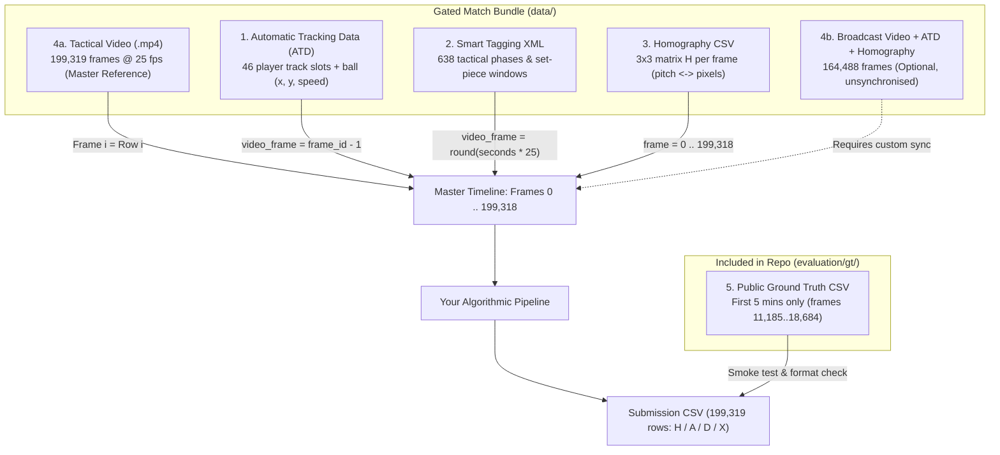

# More Than A Hack 2027 — Complete Dataset Guide

**Competition:** More Than A Hack 2027 (Phase 1: Frame-Level Ball Possession)  
**Organisers:** Metrica Sports, FC Barcelona (Barça Innovation Hub), Mobile World Capital Barcelona  
**Deadline:** November 17, 2026  

---

## 1. The Challenge in 60 Seconds

You are given **one complete professional football match**:
* **Match:** **FC Barcelona (`H`) vs. Athletic Club (`A`)** — LaLiga EA Sports 2024–25, Matchday 2.
* **Timeline:** **199,319 frames** at **25 frames per second (fps)** (~2 hours 13 minutes of video, of which **158,857 frames** / ~106 minutes of gameplay are graded).
* **Task:** Produce a single CSV file (`frame,label`) with **199,319 rows**—one label for every frame of the tactical video:

| Label | Meaning | When to Predict |
| :---: | :--- | :--- |
| **`H`** | **Home (FC Barcelona)** in controlled possession | Ball is in play (`alive`) and Barcelona controls it (or last controlled it before a loose/contested phase). |
| **`A`** | **Away (Athletic Club)** in controlled possession | Ball is in play (`alive`) and Athletic controls it (or last controlled it before a loose/contested phase). |
| **`D`** | **Dead Ball** (stoppage) | Ball is out of play (out of bounds, foul, offside, pre-kickoff, set-piece setup, goal celebration). Dead-ball team ownership is **not** asked for. |
| **`X`** | **Abstain / Ungraded** | Pre-match, halftime, post-match (never scored), or graded frames where your model chooses to abstain. |

> [!IMPORTANT]
> **Why is there no `train.csv`?** This match *is* the test set. You do **not** receive full-match labels to train a supervised classifier on this game. Your system must infer possession algorithmically using physics/geometry, state machines (HMM/Viterbi), unsupervised methods, or models trained on **other** football matches.

---

## 2. How All 5 Data Assets Fit Together



### Folder Layout Once Unpacked

```text
more-than-a-hack-2027/
├── data/                                         <-- Gated download (gitignored, never commit!)
│   ├── tactical/                                 <-- MASTER REFERENCE TIMELINE (199,319 frames)
│   │   ├── BAR-ATH_tactical.mp4
│   │   ├── BAR-ATH_tactical_atd.xml
│   │   ├── BAR-ATH_tactical_atd.txt
│   │   ├── BAR-ATH_tactical_homography.csv
│   │   └── BAR-ATH_tactical_smart_tagging.xml
│   └── broadcast/                                <-- OPTIONAL TV FEED (164,488 frames, unsynchronised)
│       ├── BAR-ATH_broadcast.mp4
│       ├── BAR-ATH_broadcast_atd.xml
│       ├── BAR-ATH_broadcast_atd.txt
│       └── BAR-ATH_broadcast_homography.csv
└── evaluation/
    └── gt/
        ├── BAR-ATH_possession_gt_public.csv      <-- 5-minute public ground truth (already in repo)
        └── BAR-ATH_possession_gt_public_meta.json
```

---

## 3. Master Timeline & Frame Alignment

Every file in `data/tactical/` lives on the exact same 25 fps clock:

| Data Source | Native Index | Formula to Get Submission Row (`video_frame`) |
| :--- | :--- | :--- |
| **Submission CSV** | `frame` (`0 … 199,318`) | Already aligned |
| **Tactical Video** | Frame `0 … 199,318` | Already aligned |
| **Homography CSV** | `frame` (`0 … 199,318`) | Already aligned |
| **Tracking (ATD)** | `frame_id` (`1 … 199,319`) | `video_frame = frame_id - 1` |
| **Smart Tagging** | `<start>`, `<end>` in seconds | `video_frame = round(seconds * 25)` |

### Graded vs. Ungraded Match Periods

| Match Period | First Frame | Last Frame | Frame Count | Graded? | Expected Output |
| :--- | :---: | :---: | :---: | :---: | :--- |
| **Pre-match** | `0` | `11,184` | 11,185 | No | `X` |
| **1st Half** | **`11,185`** | **`90,651`** | **79,467** | **Yes** | `H`, `A`, or `D` (1st-half kickoff is right at `11,185`) |
| **Halftime** | `90,652` | `110,807` | 20,156 | No | `X` |
| **2nd Half** | **`110,808`** | **`190,197`** | **79,390** | **Yes** | `H`, `A`, or `D` |
| **Post-match** | `190,198` | `199,318` | 9,121 | No | `X` |

> [!WARNING]
> **The 2nd-Half Kickoff Trap:** Grading for the 2nd half begins at frame **`110,808`**, when players are still walking into position, while the actual 2nd-half kickoff does not happen until frame **`113,742`**. Those **2,934 frames (~117 seconds)** are graded and are **100% Dead Ball (`D`)**.

---

## 4. Detailed Breakdown of the 5 Datasets

---

### Data #1: Automatic Tracking Data (ATD)

* **Files:** `data/tactical/BAR-ATH_tactical_atd.xml` (metadata) + `BAR-ATH_tactical_atd.txt` (raw per-frame positions)
* **Helper scripts:** [load_atd.py](file:///Users/shashwatagrawal/Desktop/FOR%20BARCA/more-than-a-hack-2027/starter/load_atd.py), [02_tracking_atd.ipynb](file:///Users/shashwatagrawal/Desktop/FOR%20BARCA/more-than-a-hack-2027/starter/02_tracking_atd.ipynb), [baseline.py](file:///Users/shashwatagrawal/Desktop/FOR%20BARCA/more-than-a-hack-2027/starter/baseline.py)

#### What it contains
Generated automatically by Metrica Sports' computer-vision tracker (FIFA/EPTS standard), ATD gives the 2D pitch coordinates and speed of every tracked player and the ball at 25 fps.

#### Raw `.txt` Line Structure
Each of the 199,319 lines has three colon-separated parts:
```text
<frame_id>:<slot_1>;<slot_2>;...;<slot_46>:<ball>
```
Each player slot and ball entry is `x,y,speed` (or `NaN,NaN,NaN` when not visible):
```text
11186:0.512,0.498,1.24;0.485,0.510,0.85;...;NaN,NaN,NaN:0.501,0.500,0.12
```
* **`x` and `y`:** Normalized between `0.0` and `1.0` across the pitch. Multiply `x * 105.3` and `y * 68.0` to get real **meters** (always convert to meters before computing Euclidean distances, because the pitch is rectangular, not square!).
* **`speed`:** Instantaneous speed in **meters per second (`m/s`)**.

When loaded with `kloppy` (`dataset.to_df()`), it becomes a table with columns:
`frame_id`, `ball_x`, `ball_y`, `1_x`, `1_y`, `1_s`, `2_x`, `2_y`, `2_s`, …, `46_x`, `46_y`, `46_s`.

#### Crucial Concept 1: Why are there "46 Track Slots" for 22 players?
* Slots are **NOT** pitch zones, **NOT** cameras, and **NOT** player shirt numbers (`ShirtNumber` in the XML is just the slot index).
* A **slot** is an anonymous tracking lane (`Track 1` … `Track 46`) created by the computer-vision tracker to follow a moving person.
* When two players collide in an aerial duel, overlap in a crowded penalty box, or get substituted, the tracker loses certainty about who is who. Rather than guessing, it retires the old slot (which becomes `NaN`) and opens a new slot.
* On any single frame during play, only **~20 to 22 slots** have active coordinates (mean = `20.5`), while the remaining ~24 slots are `NaN`.
* **How do you know which team a slot belongs to?** The tracker identifies jersey colors reliably. `BAR-ATH_tactical_atd.xml` permanently assigns each of the 46 `<Player>` slots a `teamId`: the first `<Team>` in the XML is **Home (`0` = Barcelona)** and the second is **Away (`1` = Athletic Club)**.

#### Crucial Concept 2: The Ball is Missing on 41% of Graded Frames!
* Ball coordinates exist on **56.9%** of all frames (`113,488 / 199,319`) and **59.3%** of graded frames (`94,214 / 158,857`).
* That means **`ball_x, ball_y` is `NaN` on 40.7% of graded frames**—especially when the ball is kicked high in the air, contested in tackles, or occluded inside crowded penalty boxes. Handling missing ball tracks is the core engineering challenge.

---

### Data #2: Smart Tagging (Automatic Tactical Phases & Set Pieces)

* **File:** `data/tactical/BAR-ATH_tactical_smart_tagging.xml` (SportsCode XML, tactical timeline only)
* **Helper scripts:** [load_smart_tagging.py](file:///Users/shashwatagrawal/Desktop/FOR%20BARCA/more-than-a-hack-2027/starter/load_smart_tagging.py), [01_smart_tagging.ipynb](file:///Users/shashwatagrawal/Desktop/FOR%20BARCA/more-than-a-hack-2027/starter/01_smart_tagging.ipynb)

#### What it contains
Metrica's automatic tactical classifier annotated **638 time intervals** across the match. Each instance has:
* `start` and `end`: Seconds from frame 0 of the tactical video (`frame = round(seconds * 25)`).
* `code`: Upper-case tactical phase or event category.
* `tags`: Key-value metadata (`Team`, `Half`, `Type`, `Side`, `Direction of ball entry`, `Max Players in the box`).

#### All 638 Instances by Category

| Tactical `code` | Count | Tactical Role |
| :--- | :---: | :--- |
| `PLAYERS IN THE BOX` | 97 | Attacking presence inside opponent penalty area |
| `BALL IN FINAL THIRD` | 93 | Attacking team operating in final third |
| `BALL IN THE BOX` | 72 | Pass, cross, or carry into opponent box |
| `PROGRESSION` | 66 | Advancing possession through midfield |
| `DEFENDING IN MIDDLE THIRD` | 66 | Organised defensive block in midfield *(implies opponent has the ball!)* |
| `SET PIECES` | 59 | Throw-in (26), Corner Kick (12), Goal Kick (10), Free Kick (5), Kick Off After Goal (4), Kick Off Start (2) |
| `CREATING CHANCES` | 30 | Key pass / dangerous finishing opportunity |
| `DEFENDING IN DEFENSIVE THIRD` | 30 | Deep defensive block near own box *(implies opponent has the ball!)* |
| `LONG BALL` | 29 | Direct aerial pass over opponent lines |
| `ATTACKING TRANSITION` | 24 | Counter-attack right after ball recovery |
| `DEFENSIVE TRANSITION` | 24 | Reorganising right after losing possession |
| `BUILD UP` | 22 | Structured possession starting from own half |
| `DEFENDING IN ATTACKING THIRD` | 22 | High press in opponent's half *(implies opponent has the ball!)* |
| `GOALS` | 4 | Ball crosses goal line (`2-1` match + disallowed/celebration sequence) |

#### Three Gotchas in Smart Tagging
1. **Spelling & `N/A` in `Team`:** Tag values are `"Barcelona"` (314), `"Atletic Club"` (288 — note the missing `'h'` in the XML!), and **`"N/A"` (36)**, which includes **every single Throw-in (all 26)**.
2. **Rough windows, not exact frames:** A `Kick Off (Start)` or `Corner Kick` interval spans ~3–5 seconds *around* the restart (starting ~3.5s before the ball is actually kicked). During the walk-up/setup before the kick, the true label is **`D` (Dead Ball)**, NOT `H` or `A`!
3. **Automatic (noisy) inference:** Like ATD, Smart Tagging is machine-generated and contains false positives/negatives. Treat it as a probabilistic prior, not ground truth.

---

### Data #3: Homography Matrices (Pitch-to-Pixel Geometry)

* **File:** `data/tactical/BAR-ATH_tactical_homography.csv` (`199,319` rows) & `data/broadcast/BAR-ATH_broadcast_homography.csv` (`164,488` rows)
* **Helper script:** [load_homography.py](file:///Users/shashwatagrawal/Desktop/FOR%20BARCA/more-than-a-hack-2027/starter/load_homography.py)

#### What it is in plain English
* The **ATD tracking** lives on a flat, top-down 2D coach's board (`0.0 … 1.0`).
* The **video** is filmed from a high stadium stand at a tilted angle, where perspective turns the rectangular pitch into a trapezoid of `1920 × 1080` pixels.
* The **Homography Matrix $H$** is a `3 × 3` grid of 9 numbers (`h00` … `h22`) for each frame that translates any normalized `(x, y)` pitch point into its exact `(pixel_x, pixel_y)` location on the video frame—and vice versa via $H^{-1}$!

$$
\begin{bmatrix} u' \\ v' \\ w' \end{bmatrix} =
\begin{bmatrix}
h_{00} & h_{01} & h_{02} \\
h_{10} & h_{11} & h_{12} \\
h_{20} & h_{21} & h_{22}
\end{bmatrix}
\begin{bmatrix} x \\ y \\ 1 \end{bmatrix},
\qquad
\text{pixel\_x} = \frac{u'}{w'}, \quad \text{pixel\_y} = \frac{v'}{w'}
$$

#### CSV Columns
`frame, h00, h01, h02, h10, h11, h12, h20, h21, h22, reprojection_error, valid`
* **`valid`:** `1` if a pitch transform exists, `0` (`NaN` matrix) if not. **100% valid** on the tactical video; **65.8% valid** on broadcast (invalid during close-ups/replays).
* **`reprojection_error`:** Calibration residual (lower = sharper fit; median `0.24` during tactical play, `~1.5` during halftime).

#### How it helps your model
1. **Finding the 41% missing ball:** Project player duel coordinates onto `BAR-ATH_tactical.mp4`, crop a small pixel patch, detect the ball with computer vision, and `unproject()` back to `(x, y)`.
2. **Boundary verification (`D`):** Check exact touchline/goal-line crossings.
3. **Visual debugging:** Draw tracked players and predicted `H`/`A`/`D` labels directly onto video clips to see *why* your algorithm made an error.

---

### Data #4: The Two Video Feeds (Tactical vs. Broadcast)

Both files are **100% real `.mp4` stadium camera recordings** (real players, grass, referee—not a 2D animation):

| Property | Tactical Video (`BAR-ATH_tactical.mp4`) | Broadcast Video (`BAR-ATH_broadcast.mp4`) |
| :--- | :--- | :--- |
| **Role** | **Master Submission Reference** (`Row i = Frame i`) | Optional supplementary input |
| **Frame Count** | **199,319 frames** (25 fps, `1920×1080`) | **164,488 frames** (25 fps, `1920×1080`) |
| **Camera Style** | Single high, static, ultra-wide "All-22" scouting cam | Multi-camera TV production (pans, zooms, pitch-side cams) |
| **Cuts & Replays** | **None** — continuous uninterrupted view of whole pitch | Frequent cuts, slow-motion replays, bench/crowd shots |
| **Own Tracking & Homography?** | Yes (46 slots, 56.9% ball, 100% homography) | Yes (51 slots, 50.5% ball, 65.8% homography) |
| **Timeline Sync** | Synchronised with submission, tactical ATD & Smart Tagging | **NOT synchronised** (mapping to tactical frames is up to you) |

> [!CAUTION]
> Never generate your submission CSV from the broadcast timeline! A submission with ~164,488 rows instead of **199,319 rows** is automatically rejected by [validate_submission.py](file:///Users/shashwatagrawal/Desktop/FOR%20BARCA/more-than-a-hack-2027/evaluation/validate_submission.py).

---

### Data #5: Public Ground Truth Snippet (`gt_public.csv`)

* **Files (already in repo):** [BAR-ATH_possession_gt_public.csv](file:///Users/shashwatagrawal/Desktop/FOR%20BARCA/more-than-a-hack-2027/evaluation/gt/BAR-ATH_possession_gt_public.csv) & [BAR-ATH_possession_gt_public_meta.json](file:///Users/shashwatagrawal/Desktop/FOR%20BARCA/more-than-a-hack-2027/evaluation/gt/BAR-ATH_possession_gt_public_meta.json)
* **Coverage:** Full 199,319-row file containing real labels **only for the first 5 minutes of play** (`frames 11,185 … 18,684` = `7,500` frames; every other frame is `X`):
  * **`H`:** 3,454 frames (`46.1%`)
  * **`A`:** 2,577 frames (`34.4%`)
  * **`D`:** 1,469 frames (`19.6%`)
  * **Structure:** **17 possessions** (mean duration **14.2 s**) across **21 contiguous segments**.
* **How ground truth is defined:** Derived mechanically from Metrica's human-corrected tracking data (`D` where corrected tracking marks ball dead; otherwise `H` or `A` for the controlling team). Simple touches, deflections, and aerial duels without subsequent control do **not** flip possession.
* **Purpose & Warning:** Provided strictly to verify frame alignment and pipeline formatting via [run_evaluation.py](file:///Users/shashwatagrawal/Desktop/FOR%20BARCA/more-than-a-hack-2027/evaluation/run_evaluation.py). **Do NOT train or tune hyperparameters on these 5 minutes**—it violates competition rules, and 17 possessions is so small that tuning a single smoothing window on it picks the *worse* full-match model!

---

## 5. How Submissions Are Ranked & Key Rules for Teammates

### Scoring Metrics ([possession_metrics.py](file:///Users/shashwatagrawal/Desktop/FOR%20BARCA/more-than-a-hack-2027/evaluation/possession_metrics.py))
1. **`spellF1` (Primary Ranking Metric):** Treats each contiguous run of `H` or `A` as one possession spell, matches predicted spells 1-to-1 against private full-match ground truth using **Temporal IoU**, and averages F1 across thresholds `0.3, 0.4, 0.5, 0.6, 0.7`. Every possession counts equally whether it lasts 3 seconds or 45 seconds. *(Baseline to beat: `0.2433`)*.
2. **`macroF1` (Tie-breaker):** Unweighted mean per-frame F1 across `H`, `A`, and `D`. *(Note: `X` on a graded frame counts as a miss in `macroF1`, whereas in `spellF1` any `X` is forward-filled from your previous label in that half).*

### Essential Competition Rules ([RULES.md](file:///Users/shashwatagrawal/Desktop/FOR%20BARCA/more-than-a-hack-2027/RULES.md) & [OVERVIEW.md](file:///Users/shashwatagrawal/Desktop/FOR%20BARCA/more-than-a-hack-2027/OVERVIEW.md))
* **Allowed:** Any algorithm, heuristic, state machine, computer-vision model, pretrained network, or supervised ML model trained on **other football matches** (e.g., open Metrica, DFL/Sportec, SkillCorner, or SoccerNet datasets).
* **Strictly Forbidden:**
  1. Hand-labelling or manually editing frames/transitions on **this** match (whether for submission, training, or validation).
  2. Using external human-produced data from **this specific match** (Opta, StatsBomb, Wyscout, LaLiga event logs).
  3. Uploading raw match videos or restricted `data/` files to cloud/third-party hosted LLMs, or committing `data/` to a public GitHub repo.
  4. Submitting a CSV that your public code repository cannot deterministically regenerate.
* **Team Size:** 3 to 5 registered members.

### Quick-Start Commands
1. Enrol & get the `data/` download link: https://landing.mobileworldcapital.com/more-than-a-hack-2027
2. Unpack into `more-than-a-hack-2027/data/` and run:
```bash
cd more-than-a-hack-2027
pip install -r requirements.txt
python evaluation/run_evaluation.py
python evaluation/validate_submission.py evaluation/results/baseline_smooth50.csv
```
